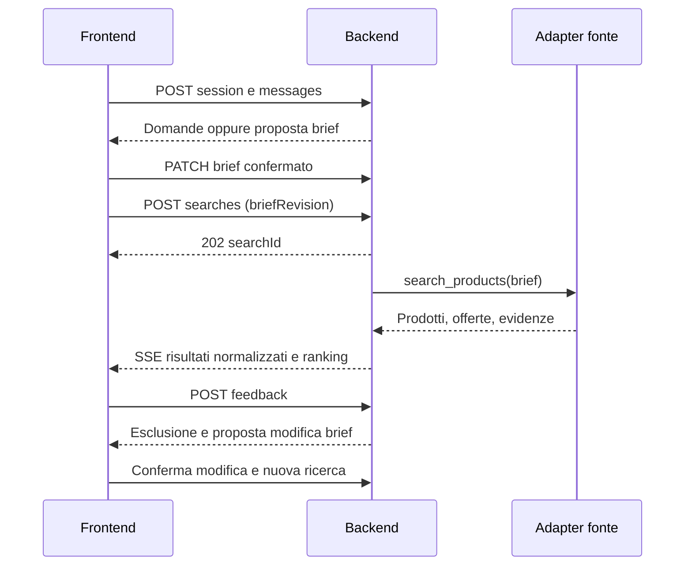

# FairBuy: proposta API e flusso MVP

Stato: proposta da discutere, non implementazione. Data: 28 ottobre 2026.

## 1. Scelta consigliata

Mantenere il percorso della demo **ASK → CONFIGURE → DISCOVER → LEARN → CHOOSE → COMPARE**, sostituendo progressivamente stato locale e fixture con un backend. Il frontend non deve conoscere provider, prompt o credenziali dei marketplace.

Tre confini:

1. **API HTTP frontend/backend**: sessioni, conversazione, brief, ricerca, feedback e confronto.
2. **Orchestratore**: interpreta la richiesta, propone caratteristiche, coordina ricerca e ranking.
3. **Adapter di fonte**, eventualmente esposti come tool MCP: restituiscono prodotti e offerte normalizzati con evidenze. MCP non è obbligatorio tra browser e backend.

Per l'hackathon userei un solo backend e un adapter fixture funzionante end-to-end, poi una fonte reale autorizzata. Niente microservizi obbligatori. Pagamenti e contatto venditori restano fuori MVP.

## 2. Percorso utente e chiamate

| Fase | Azione utente | Chiamata | Risultato |
|---|---|---|---|
| ASK | Apre una ricerca | `POST /v1/sessions` | Sessione anonima isolata e brief vuoto |
| ASK | Scrive cosa cerca | `POST /v1/sessions/{sid}/messages` | Risposta, domande mancanti, proposta di brief |
| CONFIGURE | Conferma o cambia caratteristiche e budget | `PATCH /v1/sessions/{sid}/brief` | Brief validato e nuova revisione |
| DISCOVER | Avvia ricerca | `POST /v1/sessions/{sid}/searches` | `202 Accepted`, `searchId` e URL stato/eventi |
| DISCOVER | Guarda risultati progressivi | `GET /v1/searches/{id}/events` | Eventi SSE, prodotti, stato fonti, completamento |
| LEARN | Esclude un risultato e indica il motivo | `POST /v1/sessions/{sid}/feedback` | Esclusione reversibile e possibile proposta di preferenza |
| CHOOSE | Apre un prodotto | `GET /v1/searches/{id}/products/{pid}/offers` | Offerte esatte, costi, stock, evidenze |
| COMPARE | Seleziona 2-4 prodotti | `POST /v1/sessions/{sid}/comparisons` | Tabella, compromessi e dati mancanti |

LEARN è un ciclo, non una barriera: si può tornare a CONFIGURE o DISCOVER. Anche COMPARE può precedere CHOOSE. Il backend non deve forzare un percorso rigidamente lineare.



## 3. Contratti essenziali

### Sessione e conversazione

- `POST /v1/sessions`: `{ "locale": "it-CH", "currency": "CHF" }`.
- `GET /v1/sessions/{sid}`: ripristino di messaggi, brief, esclusioni e riferimenti alle ricerche.
- `POST /v1/sessions/{sid}/messages`: `{ "clientMessageId": "uuid", "text": "Cerco un PC per gaming 1440p" }`.

La risposta contiene `assistantMessage`, `briefProposal`, `missingFields` e `readyToConfigure`. Non basta contare due messaggi come nella demo: il backend valuta quali informazioni sono disponibili. Un testo successivo non cambia silenziosamente categoria o vincoli già confermati; restituisce una proposta esplicita.

### Brief versionato

`PATCH /v1/sessions/{sid}/brief`, con `If-Match` impostato all'ETag letto in precedenza:

```json
{
  "category": "gaming_pc",
  "budget": { "minMinor": 120000, "maxMinor": 240000, "currency": "CHF", "basis": "delivered_total" },
  "location": { "country": "CH", "city": "Zurich" },
  "requirements": [
    { "id": "ram", "key": "ram_gb", "operator": "gte", "value": 32, "mode": "preferred" },
    { "id": "condition", "key": "condition", "operator": "eq", "value": "new", "mode": "required" },
    { "id": "wifi", "key": "custom", "text": "Wi-Fi 7", "mode": "preferred", "verification": "unknown" }
  ]
}
```

Valori monetari interi in centesimi. Il minimo budget è normalmente una preferenza, il massimo un limite: renderlo esplicito nel contratto definitivo. Il backend assegna `revision` ed ETag; una versione superata produce `412 Precondition Failed`. `verification` e campi derivati vengono calcolati dal backend, non accettati come prova dal client.

Distinguere caratteristiche **required** e **preferred**. Un testo libero non supportato rimane `unknown`, non diventa automaticamente compatibile. Per GPU usare attributi e benchmark documentati, non ordinare i nomi commerciali numericamente.

### Ricerca asincrona

`POST /v1/sessions/{sid}/searches`:

```json
{ "briefRevision": 3, "sources": ["fixture"], "limit": 20 }
```

Risposta `202`:

```json
{
  "searchId": "search_123",
  "briefRevision": 3,
  "status": "queued",
  "statusUrl": "/v1/searches/search_123",
  "eventsUrl": "/v1/searches/search_123/events"
}
```

- `GET /v1/searches/{id}`: stato, snapshot risultati, stato delle singole fonti e cursore eventi.
- `POST /v1/searches/{id}/cancel`: annullamento idempotente.
- Stati: `queued → running → completed | partial | failed | cancelled`. `partial` indica risultati utilizzabili ma copertura incompleta per errori, timeout o limiti.
- La ricerca usa uno snapshot immutabile del brief. Cambiare filtri crea una nuova ricerca; il frontend ignora eventi della vecchia.
- SSE: `source.status`, `product.upsert`, `offer.upsert`, `search.completed`, `search.partial`, `search.failed`, `search.cancelled`. Ogni evento include `id`, `searchId`, `briefRevision` e `occurredAt`.
- Supportare `Last-Event-ID` per riconnessione; se il cursore è scaduto, recuperare lo snapshot. `GET` con polling moderato è il fallback.
- Non simulare obbligatoriamente un prodotto ogni due secondi: mostrare i risultati appena pronti.

### Prodotto, offerta ed evidenza

Tenere separati `Product` (modello/configurazione) e `Offer` (venditore, prezzo e disponibilità). RAM, GPU, storage e condizione fanno parte dell'identità della variante: non fondere configurazioni diverse solo perché il titolo è simile.

Un'offerta deve includere:

```json
{
  "id": "offer_1",
  "productId": "product_1",
  "source": "fixture",
  "seller": "Demo seller",
  "currency": "CHF",
  "itemMinor": 180000,
  "shippingMinor": null,
  "feesMinor": null,
  "deliveredTotalMinor": null,
  "stock": "unknown",
  "observedAt": "2026-10-28T18:00:00Z",
  "evidence": { "kind": "synthetic", "url": null },
  "unverifiedFields": ["shippingMinor", "feesMinor", "stock"]
}
```

`null` significa sconosciuto, non zero. Calcolare il totale solo con tutte le componenti richieste note e applicabili alla destinazione. Mostrare separatamente le offerte a totale non confermato. Il ranking deve spiegare `hardFailures`, `softMisses`, `unknown` e motivi della raccomandazione. Score di compatibilità e confidenza delle evidenze sono concetti diversi.

### Feedback e apprendimento controllato

`POST /v1/sessions/{sid}/feedback`:

```json
{
  "clientActionId": "uuid",
  "searchId": "search_123",
  "productId": "product_1",
  "action": "exclude",
  "reason": "insufficient_ram",
  "note": "Preferisco almeno 32 GB"
}
```

Risposta: `feedbackId`, esclusione applicata e, se utile, `suggestedBriefPatch`. Escludere un prodotto non modifica automaticamente tutti i filtri. L'utente conferma la proposta tramite PATCH del brief.

- `GET /v1/sessions/{sid}/feedback`: log LEARN.
- `POST /v1/sessions/{sid}/feedback/{fid}/undo`: annulla l'effetto di esclusione e lo registra nel log. Non annulla eventuali modifiche del brief confermate separatamente.
- `PUT /v1/sessions/{sid}/favorites/{pid}` e `DELETE` corrispondente: preferiti idempotenti, dopo il nucleo MVP.

### Confronto

`POST /v1/sessions/{sid}/comparisons`: `{ "searchId": "search_123", "productIds": ["product_1", "product_2"] }`.

Risposta: caratteristiche normalizzate, miglior totale confermato per prodotto, fonti/timestamp, trade-off e campi sconosciuti. Non inventare prestazioni, disponibilità o garanzie. Nel MVP i prodotti provengono dallo stesso snapshot di ricerca.

## 4. Tool MCP e adapter di marketplace

Esporrei all'orchestratore pochi tool stabili, con JSON Schema versionati:

| Tool | Input principale | Output |
|---|---|---|
| `list_sources` | categoria, paese | Fonti abilitate, capacità e disponibilità |
| `search_products` | brief normalizzato, sourceIds, cursor, limit | Candidati normalizzati, offerte, evidenze, errori per fonte |
| `get_product_details` | sourceId, sourceProductId | Attributi della variante e provenienza |
| `get_product_offers` | sourceId, sourceProductId, destinazione approssimata | Offerte, costi noti e campi mancanti |

Non fare un tool diverso per ogni negozio nel contratto pubblico. Dietro il tool, ogni adapter implementa `capabilities`, `search`, `details`, `offers`, con timeout, limiti, paginazione e normalizzazione propri. Il guasto di una fonte non blocca le altre. Un endpoint operativo interno di stato fonti può arrivare dopo, senza esporre segreti o stack trace al browser.

HTTP e MCP riusano gli stessi modelli di dominio ma non sono copie uno dell'altro: il browser gestisce il percorso, i tool recuperano dati. Risultati delle fonti e testi dei venditori sono dati non attendibili, mai istruzioni per l'agente.

## 5. Regole trasversali da fissare subito

- **Isolamento:** sessione anonima legata a cookie opaco `HttpOnly`, `Secure`, `SameSite`; controllo di proprietà su ogni risorsa. Conoscere un ID non concede accesso. Proteggere le mutazioni da CSRF e limitare richieste/costi.
- **Idempotenza:** `Idempotency-Key` per creazione sessioni, messaggi, ricerche e feedback; stessa chiave e stesso payload restituiscono lo stesso risultato, payload diverso produce conflitto.
- **Errori:** `application/problem+json`, con `type`, `title`, `status`, `detail`, `requestId` e, dove utile, errori di campo. `400` sintassi, `422` dominio, `404` risorsa non accessibile, `409` conflitto, `412` revisione, `429` limite. Indicare `Retry-After` quando applicabile.
- **Privacy:** iniziare da città/CAP; indirizzo preciso solo quando necessario per una quotazione e con consenso. Non inviarlo a tutte le fonti. Nessun indirizzo nei log. Definire scadenza sessioni e `DELETE /v1/sessions/{sid}` con cancellazione dei dati associati.
- **Copertura:** zero risultati non significa che il prodotto non esiste; indicare quali fonti sono state interrogate, quali hanno fallito e quanto sono freschi i dati.
- **Valuta:** MVP in CHF, nessuna conversione implicita. Una fonte in altra valuta viene separata o esclusa esplicitamente.
- **Audio:** opzionale e successivo. Eventuale `POST /v1/audio/transcriptions` separato dalla chat, con faster-whisper locale, limiti file e cancellazione audio; il testo trascritto rientra nel normale endpoint messaggi. TTS non blocca il flusso testuale.

## 6. Ordine di implementazione

1. Definire OpenAPI 3.1 per sessione, messaggi, brief, ricerca e risultati; riusare JSON Schema per i tool MCP.
2. Implementare backend con adapter fixture e stesso percorso della demo. Nessun accesso live necessario per validare i contratti.
3. Collegare ASK e CONFIGURE senza cambiare il layout; salvare stato e revisione sul backend.
4. Collegare DISCOVER a job e snapshot, poi SSE, annullamento e riconnessione.
5. Collegare feedback reversibile, offerte e confronto.
6. Aggiungere una fonte reale autorizzata, verificando provenienza, limiti e risultati parziali. Aggiungere MCP quando serve un consumatore agente, non come prerequisito del browser.

**Primo traguardo:** richiesta testuale → brief confermato → ricerca fixture → risultati con evidenze → esclusione reversibile → confronto. Deve funzionare anche con una fonte in errore e dopo refresh della pagina.

## 7. Criteri di accettazione del contratto

- Due richieste duplicate non creano due job o due messaggi.
- Una modifica concorrente non sovrascrive silenziosamente il brief.
- Eventi di una ricerca vecchia non inquinano i nuovi risultati.
- Una fonte fallita produce risultati parziali espliciti, non un falso successo completo.
- Costi sconosciuti non diventano zero; fixture non appaiono come dati reali.
- Una caratteristica custom rimane non verificata finché non esiste evidenza.
- Esclusione e ripristino non alterano di nascosto preferenze confermate.
- Un'altra sessione non può leggere messaggi, risultati o feedback altrui.

## 8. Collegamento al codice esistente

Questa proposta deriva dal README e dai tipi locali della demo, non descrive API già presenti.

- `src/data/fixtures.ts`: base per separare `Product`, `Offer`, `Brief`; migrare gli importi decimali a minor units nel contratto di rete.
- `src/lib/flow.ts`: base per caratteristiche required/preferred e gestione degli unknown.
- `src/lib/matching.ts` e `src/lib/sellers.ts`: logica da mantenere deterministica e verificabile sul backend.
- `src/lib/mockReplies.ts`: sostituibile con un servizio conversazionale dietro l'endpoint messaggi.
- `src/App.tsx`: sostituire progressivamente stato e timer di discovery con un client API, conservando navigazione e interazioni.

Non è necessario riscrivere tutta la demo prima di concordare questi contratti.
